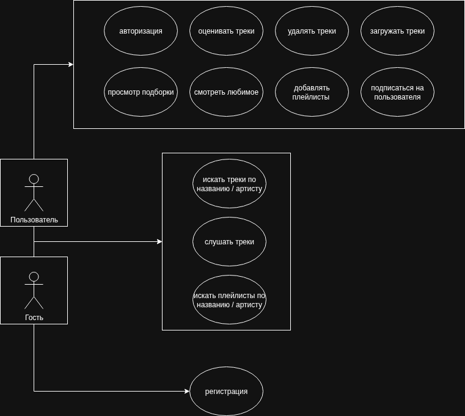
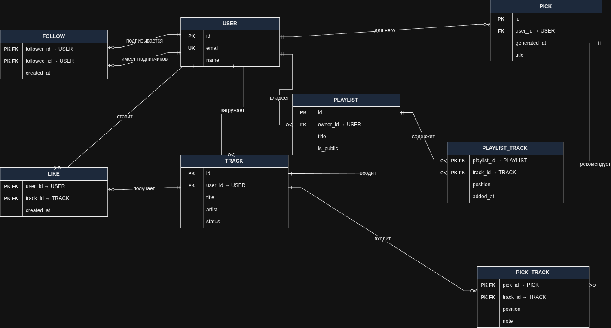
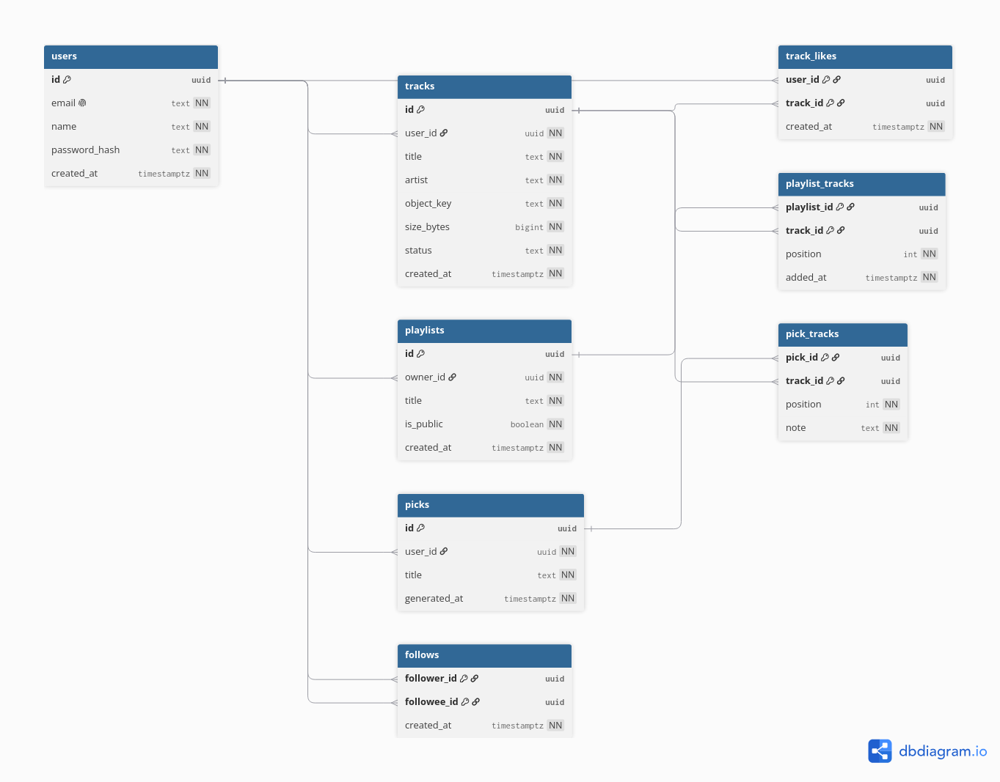
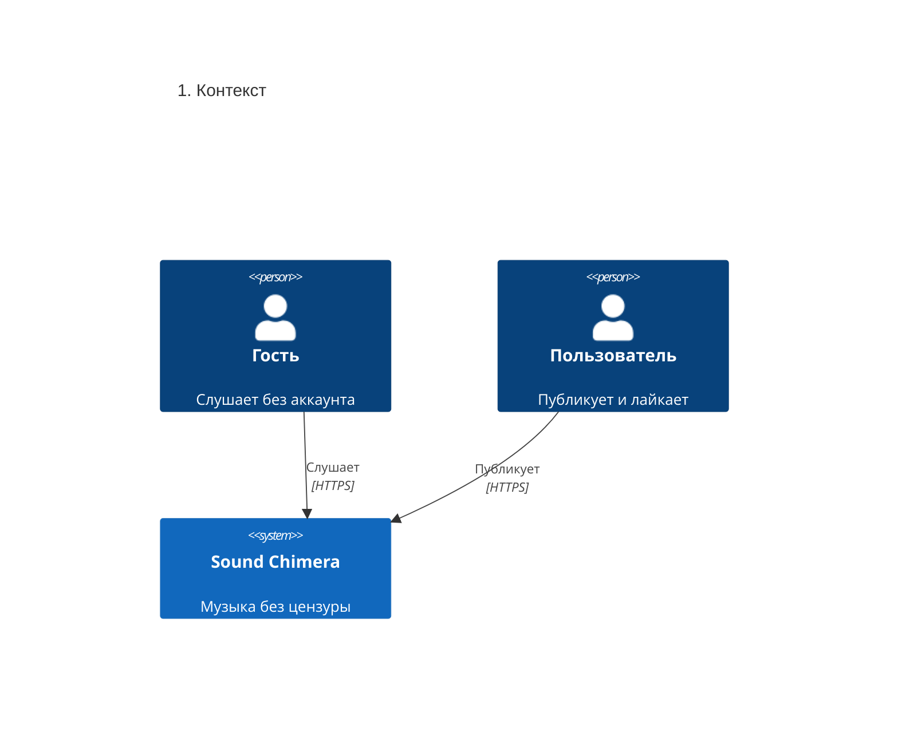
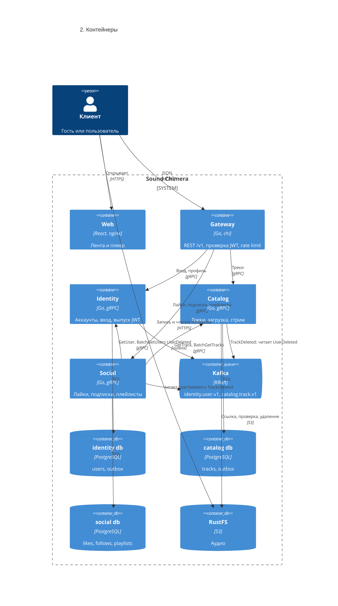
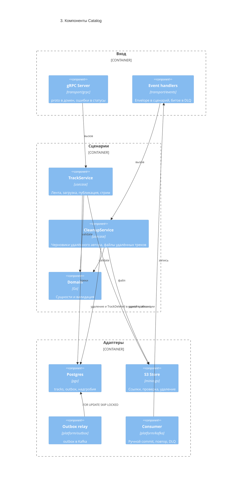
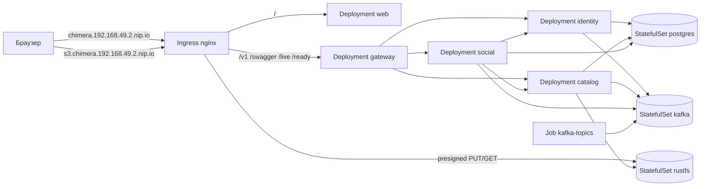

# Chimera — архитектурное описание

**Sound Chimera** — универсальный веб-сервис для прослушивания музыки без цензуры и ограничений. Слушатель открывает каталог и играет готовые треки без регистрации. Автор сам публикует файл, и трек попадает в общий эфир.

## 1. Цель работы

Сделать сервис, в котором музыку можно слушать без цензуры и без обязательных посредников.

Сейчас прослушивание упирается либо в отбор контента, либо в обходные средства вроде VPN. Chimera даёт прямой каталог: гость слушает, автор публикует, пользователь отмечает любимое.

Пользователь может:

- слушать ленту и каталог автора без аккаунта;
- зарегистрироваться, загружать треки и отмечать любимые;
- видеть свои загрузки, включая ещё не опубликованные.

## 2. Требования

### Функциональные


| ID   | Требование                               | Как сделано сейчас                                                                        |
| ---- | ---------------------------------------- | ----------------------------------------------------------------------------------------- |
| FR-1 | Регистрация и вход по email и паролю     | `POST /v1/auth/register`, `POST /v1/auth/login`                                           |
| FR-2 | Публичная лента готовых треков           | `GET /v1/tracks`                                                                          |
| FR-3 | Поиск ленты по имени артиста             | query `artist`                                                                            |
| FR-4 | Публикация трека                         | `POST /v1/tracks/upload-init`, запись в хранилище, `POST /v1/tracks/{id}/upload-complete` |
| FR-5 | Воспроизведение готового трека           | `GET /v1/tracks/{id}/stream` ведёт на временную ссылку                                    |
| FR-6 | Лайк, снятие лайка, список любимого      | `POST/DELETE /v1/tracks/{id}/like`, `GET /v1/me/likes`                                    |
| FR-7 | Свои загрузки и публичный каталог автора | `GET /v1/me/tracks`, `GET /v1/users/{id}/tracks`                                          |
| FR-8 | Профиль и справочник пользователей       | `GET /v1/me`, `GET /v1/users`, `GET /v1/users/{id}`                                       |
| FR-9 | Подписки и списки подписчиков            | `PUT/DELETE /v1/users/{id}/follow`, списки `followers` и `following`                       |
| FR-10 | Публичные и скрытые плейлисты           | CRUD плейлистов и управление позициями готовых треков                                     |


Загрузка, лайки и остальные изменения каталога требуют токен. Лента, карточка трека, стрим и каталог автора открыты без входа.

Целевой контракт — [OpenAPI](openapi.yaml). Что уже есть в коде и таблица сценариев — [api.md](api.md).

### Нефункциональные

**Доступ.** Готовый трек можно слушать без регистрации. Каталог не режется по содержанию: публикация и прослушивание не проходят модерацию.

**Файлы.** Аудио пишется и читается по короткой временной ссылке, не через API. Слишком большой файл не принимается.

**Вход.** Регистрация и вход ограничиваются по IP до проверки пароля. Число запросов и окно задают `AUTH_RATE_LIMIT` и `AUTH_RATE_WINDOW`. Отказ не сообщает, какая квота сработала, возвращает `Retry-After`, а счётчик живёт в памяти процесса.

## 3. Диаграмма вариантов использования

**Пользователь** обобщает **Гостя**: ему доступны гостевые варианты и свои. Подписки и плейлисты доступны через API.



`Опубликовать трек` включает проверку размера, запись объекта и смену статуса. В любимое и плейлист попадает только готовый трек. Неготовый трек нельзя ни лайкнуть, ни слушать. Поиск по артисту — та же лента с фильтром.

## 4. BPMN основных процессов

### Регистрация и вход


### Прослушивание трека


### Постановка лайка


## 5. Пользовательские сценарии

### Сценарий 1. Гость слушает ленту

1. Гость открывает ленту. В списке только готовые треки: название, артист, воспроизведение.
2. Нажатие play запрашивает стрим и получает ссылку на объект.
3. Нижняя панель показывает название, артиста, паузу и перемотку.

### Сценарий 2. Автор публикует трек

1. Автор открывает загрузку. Без сессии клиент уводит на вход.
2. Он вводит название, артиста и выбирает файл.
3. Браузер отправляет файл в хранилище.
4. Клиент подтверждает загрузку.
5. Автор видит загрузку у себя. 

### Сценарий 3. Пользователь собирает любимое

1. Пользователь входит.
2. В ленте он ставит или снимает сердечко.
3. Экран любимого показывает только готовые лайкнутые треки.

### Сценарий 4. Поиск каталога артиста

1. Пользователь вводит имя артиста в шапке.
2. Клиент открывает каталог артиста и запрашивает ленту с этим фильтром.
3. Совпадение точное, без учёта регистра и краевых пробелов.
4. Клик по имени артиста в строке трека ведёт на тот же экран. Пустой результат — «Готовых треков с таким артистом нет».

## 6. ER-диаграмма



## 7. Технологический стек


| Слой                 | Выбор                                                        |
| -------------------- | ------------------------------------------------------------ |
| Публичный API        | Gateway: Go, `net/http`, chi, REST `/v1`, Swagger            |
| Внутренние вызовы    | gRPC, protobuf, `buf` (lint, breaking, генерация)            |
| События              | Kafka (KRaft), `franz-go`, transactional outbox              |
| Сессия               | JWT EdDSA (Ed25519): выпускает Identity, проверяет Gateway; пароли bcrypt |
| Данные               | PostgreSQL, `pgx`, база и роль на сервис, `golang-migrate`   |
| Файлы                | RustFS (S3 API), временные ссылки на запись и чтение         |
| Логи                 | `log/slog`, сквозной `run_id` через HTTP-заголовки и gRPC-метаданные |
| Клиент               | TypeScript, React, React Router, Vite                        |
| Развёртывание        | Docker Compose; Kubernetes (minikube) через kustomize        |


Секреты, порты и лимиты читаются из окружения. Без обязательной переменной процесс не стартует.

Код — Go workspace `backend/go.work` из отдельных модулей:

```
backend/
  contracts/  proto, сгенерированный Go, buf.yaml        (make proto)
  platform/   логгер, env, grpcx, health, pg, outbox, kafka — без бизнес-правил
  testkit/    RunSpec, Allure, тестовая база — только для тестов
  identity/   cmd/identity, internal/{domain,usecase,infra,transport/grpc}, migrations
  catalog/    cmd/catalog,  internal/{domain,usecase,infra,transport/{grpc,events}}, migrations
  social/     cmd/social,   internal/{domain,usecase,infra,transport/{grpc,events}}, migrations
  gateway/    cmd/gateway,  internal/{transport/http/{v1,middleware},clients,infra/auth}, docs
  e2e/        демо-сценарий через Gateway
```

Внутри каждого сервиса зависимости идут внутрь: `transport` → `usecase` → `domain`, реализации портов — в `infra`. Сборка в `cmd/<service>/main.go`: конфигурация, пул Postgres, миграции, адаптеры, сценарии, outbox relay и консьюмеры, gRPC-сервер, health-monitor.

## 8. Диаграмма базы данных



Диаграмма — логическая модель. Физически это три базы в одном PostgreSQL, у каждой своя роль, и чужие базы сервис не читает:

| База       | Владелец | Таблицы                                                                        |
| ---------- | -------- | ------------------------------------------------------------------------------ |
| `identity` | Identity | `users`, `outbox`                                                              |
| `catalog`  | Catalog  | `tracks`, `outbox`, `deleted_users`, `processed_events`                        |
| `social`   | Social   | `track_likes`, `user_follows`, `playlists`, `playlist_tracks`, `deleted_users`, `deleted_tracks`, `processed_events` |

Между базами внешних ключей нет: `tracks.user_id` и `track_likes.track_id` — просто идентификаторы. Каскад, который раньше делал `ON DELETE CASCADE`, теперь делают события (ADR-5). Таблицы `deleted_users` и `deleted_tracks` — надгробия: консьюмер записывает id удалённой сущности, и запись, которая пришла позже события (лайк удалённого трека, трек удалённого автора), отклоняется как `not found` в той же транзакции. `processed_events` делает обработку события идемпотентной.

Внутри базы сервиса связи остаются внешними ключами: позиции плейлиста удаляются вместе с плейлистом и уплотняются триггером. Миграции — нумерованные `migrations/*.sql`, встроены в бинарь и применяются на старте до создания репозиториев.

## 9. C4

### 9.1. Контекст

Снаружи только люди. База, брокер и хранилище — части самой системы.



Почты, платежей и CDN нет.

### 9.2. Контейнеры

Файл в сервисы не заходит: браузер пишет и читает объект по временной ссылке. Синхронные вызовы — gRPC, последствия удалений — события Kafka.



| Сервис   | Владеет                                  | Публикует        | Читает (группа)                                          | Вызывает синхронно |
| -------- | ---------------------------------------- | ---------------- | -------------------------------------------------------- | ------------------ |
| Identity | пользователи, пароли, выпуск токенов     | `UserDeleted`    | —                                                        | —                  |
| Catalog  | треки, объекты в бакете                  | `TrackDeleted`   | `UserDeleted` (`catalog`), `TrackDeleted` (`catalog-objects`) | —             |
| Social   | лайки, подписки, плейлисты               | —                | `UserDeleted`, `TrackDeleted` (`social`)                 | Catalog, Identity  |
| Gateway  | ничего                                   | —                | —                                                        | все три            |

Маршруты Gateway: `/v1/sessions` и `/v1/users*` — Identity; `/v1/tracks*` — Catalog, кроме `GET /v1/tracks?liked_by=` и `/v1/users/{id}/likes/*`, которые идут в Social; `/v1/follows*` и `/v1/playlists*` — Social. Внешний контракт ([openapi.yaml](openapi.yaml)) остался прежним.

### 9.3. Компоненты сервиса

Все три gRPC-сервиса устроены одинаково; на диаграмме — Catalog, у которого есть все виды компонентов.



Порты объявлены там, где их вызывают: репозитории и хранилище — в сценариях, сценарии — в gRPC-сервере и обработчиках событий. Gateway устроен как прежний HTTP-слой: контроллеры `v1` и middleware не изменились, а их порты (`TrackService`, `UserService` и так далее) теперь реализуют gRPC-клиенты из `internal/clients`.

### 9.4. Развёртывание



Манифесты — `deploy/k8s/base` и overlay `deploy/k8s/overlays/minikube` (хосты nip.io, `TRUSTED_PROXIES`, секреты из gitignored `secrets.env` и ключей). Сервисы доступны только как `ClusterIP`. Пробы gRPC-сервисов: readiness — `grpc.health.v1` с учётом Postgres, S3 и Kafka-зависимостей; liveness — отдельное имя `chimera.liveness`, которое не зависит от зависимостей; startup-проба даёт до пяти минут на ожидание базы. Readiness Gateway — `/live`: падение одного сервиса не выводит весь API из ingress, вызовы к упавшему сервису отвечают `503` сами. Запуск: `make k8s-images k8s-up`, проверка — `make k8s-e2e`.

## 10. Архитектурные решения

### ADR-1. Файл идёт мимо API

**Контекст.** Аудио тяжёлое. Если гнать байты через API, процесс держит тело запроса и упирается в память и таймаут.

**Решение.** Создание трека возвращает временную ссылку на запись. Браузер пишет объект в RustFS. Подтверждение сверяет владельца и размер и публикует трек. Стрим — переход на временную ссылку чтения. Если ссылку выдать не удалось, строка трека удаляется.

**Альтернативы.** Проксировать файл через API проще для клиента, но API становится узким местом. Сборка файла по частям нужна для докачки, для одной записи это лишняя машина состояний.

**Почему так.** Клиент знает размер до старта, хранилище отдельно от API, постоянной публичной ссылки на бакет нет.

### ADR-2. Слои и порты на стороне потребителя

**Контекст.** Сценарии загрузки, ленты и входа нужно проверять без базы и хранилища. Правила трека не должны знать про HTTP и SQL.

**Решение.** Домен не импортирует HTTP, SQL и JWT. Проверки живут на моделях входа. Сценарий только вызывает проверку, репозиторий и хранилище и меняет статус. Интерфейсы объявлены у того, кто их вызывает. Миграции сервиса применяются при старте, до создания репозиториев.

**Альтернативы.** SQL рядом с правилами статуса быстрее на старте, но тест публикации начинает требовать базу. Если порты объявить в домене, домен узнает про технические операции хранилища.

**Почему так.** Статусы и проверки владельца, размера и пароля покрываются тестами без Postgres и RustFS. Подмена хранилищ — другие реализации тех же портов.

### ADR-3. Три сервиса по бизнес-возможностям и Gateway

**Контекст.** Монолит держал аккаунты, каталог и социальные функции в одном процессе и одной базе. Каталог — горячий путь чтения (лента, стрим), вход — редкий и дорогой (bcrypt), социальные функции растут быстрее остальных. Падение любой части роняло всё.

**Решение.** Identity (аккаунты, вход, выпуск токенов), Catalog (треки, файлы) и Social (лайки, подписки, плейлисты) — отдельные процессы с отдельными базами. Gateway — edge без бизнес-правил и без данных: REST, проверка JWT, rate limit, маршрутизация. Межсервисные связи — только идентификаторы.

**Альтернативы.** Деление по слоям (сервис «база», сервис «API») не даёт независимого выпуска. Отдельный сервис на плейлисты или подписки дробит одну возможность и плодит синхронные вызовы между ними. Без Gateway фронту пришлось бы знать три адреса и проверять токен в каждом сервисе.

**Почему так.** Связей между возможностями мало: Social ссылается на `track_id` и `user_id`, Catalog — на `user_id`. Отказ Catalog оставляет работающими вход и профиль, отказ Social — ленту и стрим (проверено в minikube).

### ADR-4. REST на краю, gRPC внутри; GraphQL и SOAP отклонены

**Контекст.** Фронт уже работает по утверждённому REST-контракту; стриму нужен `302`. Внутренние вызовы синхронные: ответ нужен, чтобы ответить пользователю.

**Решение.** Браузер и Gateway — REST (контракт `openapi.yaml` без изменений). Gateway и сервисы, сервисы между собой — gRPC по proto из `backend/contracts`. Код ошибки едет в `google.rpc.ErrorInfo` (`platform/grpcx`), Gateway переводит его в тот же HTTP-статус и `{code, message}`; недоступный сервис или истёкший дедлайн дают `503`. Совместимость proto проверяет `buf breaking` в CI.

**Альтернативы.** REST/JSON внутри — без типизированного контракта и проверки совместимости. GraphQL — второй публичный контракт без второго клиента; композиция данных нужна в двух местах (любимое, состав плейлиста), и её делает Social. SOAP — нет внешних интеграторов с WS-*, XML внутри кластера проигрывает gRPC по размеру, скорости и инструментам.

**Почему так.** Типизированный контракт с кодогенерацией, HTTP/2, дедлайны через `ctx`, нативная gRPC-проба в Kubernetes.

### ADR-5. Kafka и transactional outbox для каскада удалений; RabbitMQ и Webhooks отклонены

**Контекст.** После разделения баз `ON DELETE CASCADE` между сервисами невозможен. Удаление пользователя не должно синхронно ждать Catalog и Social и падать, если один из них лежит.

**Решение.** Identity публикует `UserDeleted`, Catalog — `TrackDeleted` (`events/v1/events.proto`, ключ — id сущности). Удаление строки и запись в `outbox` — одна транзакция; relay публикует с `acks=all` и ставит `sent_at` (at-least-once). Консьюмеры — группа на назначение (`catalog`, `catalog-objects`, `social`), offset коммитится после обработки, `processed_events` и надгробия в той же транзакции делают обработку идемпотентной, временная ошибка повторяется с паузой, битое сообщение уходит в `<topic>.dlq`. Топики создаёт отдельный Job, автосоздание выключено.

**Альтернативы.** Синхронные вызовы из Identity в Catalog и Social — удаление падает при недоступности любого. RabbitMQ при двух типах событий был бы проще, но не хранит историю: новый потребитель не перечитает прошлые события, а лежавший сервис зависит от того, успела ли очередь их удержать. Webhooks нужны внешним системам, которые не могут читать брокер; внутри кластера это лишний HTTP-контракт с собственными повторами. WebSocket не нужен: сервер ничего не шлёт клиенту сам.

**Почему так.** Долговечный лог с перечитыванием, fan-out через consumer groups без изменений продюсера, порядок событий одной сущности. Цена — каскад стал eventual: лайки и плейлисты удалённого трека исчезают через доли секунды, при лежащем консьюмере — после его старта. Зато файлы удалённых треков теперь удаляются из бакета.

### ADR-6. Ed25519 вместо общего секрета

**Контекст.** В монолите один процесс и выпускал, и проверял HS256-токены общим секретом. Отдать этот секрет Gateway — значит позволить ему выпускать токены.

**Решение.** Identity подписывает EdDSA приватным ключом, Gateway проверяет публичным (`WithValidMethods(EdDSA)`, обязательный `exp`). Ключи генерируются локально (`deploy/keygen`, `make k8s-keys`) и в git не попадают; приватный ключ монтируется только в Identity.

**Почему так.** Утечка Gateway не даёт выпустить токен. Цена — старые HS256-токены не принимаются, нужно войти заново.
