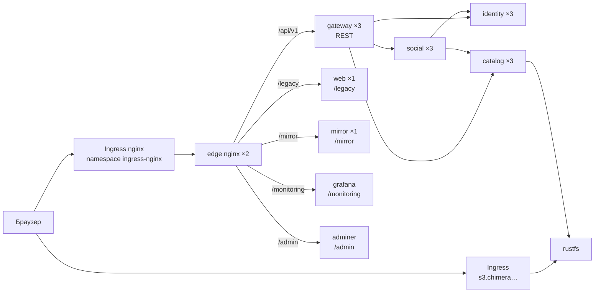
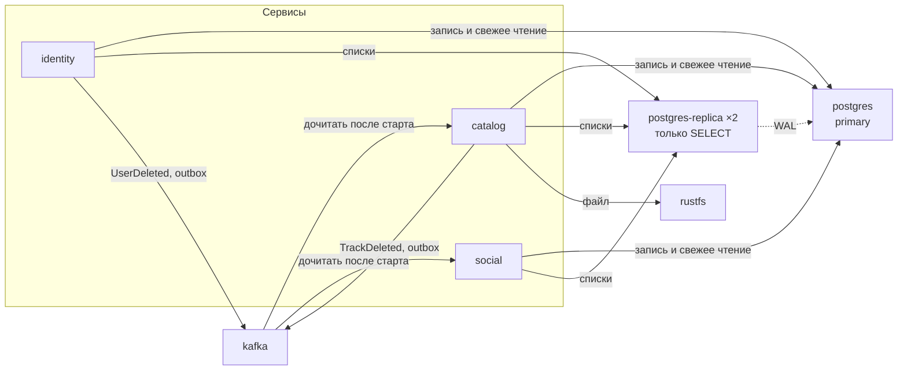
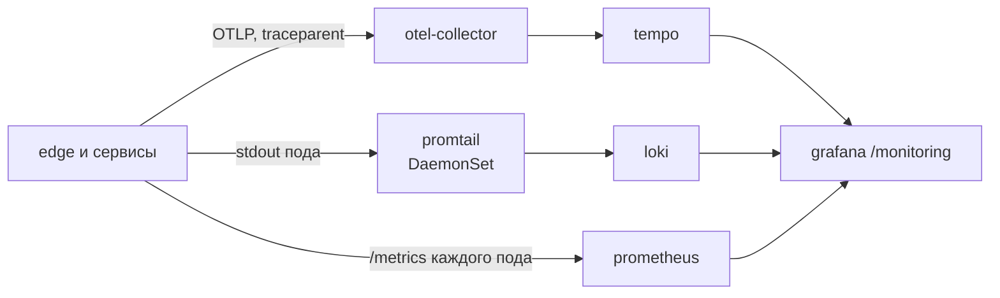

# Chimera в minikube

Один namespace `chimera`. Снаружи два имени: сайт и API на `chimera.192.168.49.2.nip.io`, файлы на `s3.chimera.192.168.49.2.nip.io`. `kubectl` к этому пути не относится: им управляют кластером, а запрос пользователя идёт через Ingress.

Команды ниже запускаются из `backend/`. `make` зовёт кластер так: `minikube kubectl --`.

## Путь запроса



Ingress принимает HTTP и отдаёт его целиком в edge. Дальше путь разбирает уже edge:

| Путь | Куда |
| --- | --- |
| `/`, `/status`, `/documentation` | статика самого edge |
| `/api/v1/...` | Gateway, префикс `/api` снимается: наружу `/api/v1/tracks`, внутри `/v1/tracks` |
| `/legacy/` | SPA |
| `/mirror/` | та же SPA, собранная с базой `/mirror` |
| `/monitoring/` | Grafana |
| `/admin/` | Adminer, basic auth |
| `s3.chimera…/` | RustFS напрямую, мимо edge: так устроена временная ссылка на файл |

Gateway проверяет JWT и зовёт сервисы по gRPC. Адрес вида `dns:///catalog-headless:9090`: headless Service даёт по одному адресу на под, клиент распределяет вызовы round robin. Social так же ходит в Catalog и Identity.

Ответ несёт три заголовка. `X-Request-Id` — `trace_id` всего пути. `X-Chimera-Instance` — под Gateway. `X-Chimera-Upstreams` — поды сервисов, которые ответили на gRPC этого запроса.

## Данные



У каждого сервиса своя база на одном Postgres. Primary принимает запись. Две реплики принимают только чтение списков и карточек. Не ответила реплика или на ней ещё нет строки — тот же запрос уходит на primary. Вход, регистрация и чтение только что созданной сущности идут на primary сразу.

Удаление не ждёт соседний сервис. Identity и Catalog пишут событие в свою таблицу `outbox` в той же транзакции, что и удаление строки. Отдельный цикл публикует его в Kafka. Catalog и Social читают топики своей группой; пока под лежит, запись остаётся в топике и будет прочитана после старта.

## Наблюдаемость



Prometheus забирает метрики через headless Service: три цели у Gateway, Identity, Catalog и Social, плюс лаг реплик с postgres-exporter и лаг консьюмеров с kafka-exporter. В логе продакшена есть поле `trace_id`. В Grafana оно ведёт в Tempo, из спана Tempo обратно в строки Loki.

## Запуск

Нужен запущенный minikube и аддон ingress. Из `backend/`:

```sh
make k8s-up
```

Цель сама включает ingress, собирает образы в узел minikube (`make k8s-images` можно вызвать отдельно), применяет `deploy/k8s/overlays/minikube` и ждёт поды. Ключи JWT и `secrets.env` создаются один раз, если их ещё нет. Пароли лежат в `deploy/k8s/overlays/minikube/secrets.env` и в git не попадают.

Повторный `make k8s-up` применяет манифесты заново и ждёт готовности. `make k8s-down` удаляет namespace вместе с томами: базы и бакет станут пустыми.

## Куда смотреть

Сайт и API:

- http://chimera.192.168.49.2.nip.io/
- http://chimera.192.168.49.2.nip.io/api/v1/tracks
- http://chimera.192.168.49.2.nip.io/legacy/
- http://chimera.192.168.49.2.nip.io/mirror/
- http://chimera.192.168.49.2.nip.io/monitoring/
- http://chimera.192.168.49.2.nip.io/admin/

Кластер:

```sh
make k8s-status
make k8s-logs SVC=gateway
```

`SVC` — имя workload: `gateway`, `identity`, `catalog`, `social`, `edge`, `postgres`, `postgres-replica`, `kafka`.

Один запрос целиком:

```sh
curl -sD - -o /dev/null http://chimera.192.168.49.2.nip.io/api/v1/tracks
```

`X-Request-Id` из ответа ищется в Grafana на `/monitoring`: строка лога открывает трейс, трейс открывает строки всех сервисов этого запроса. Дашборд Chimera показывает RPS, ошибки, повторы gRPC, лаг реплик и лаг консьюмеров.

Prometheus и Tempo снаружи кластера не опубликованы. `make k8s-monitoring` печатает команды `kubectl port-forward`.

Проверки:

| Команда | Что делает |
| --- | --- |
| `make k8s-e2e` | сквозной сценарий через edge |
| `make k8s-load` | распределение чтений по подам, `loadtest/balance.js` |
| `make k8s-chaos` | удаление пода Catalog, выключение Catalog, выключение реплик |
| `make k8s-replay-dlq` | вернуть записи из DLQ в исходные топики |
